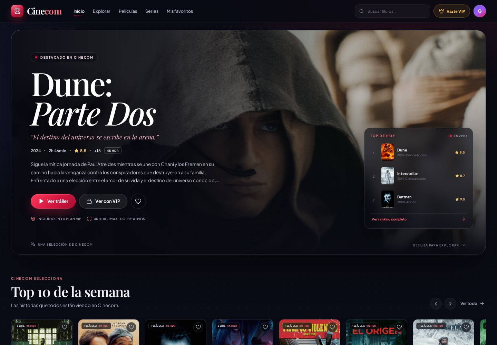
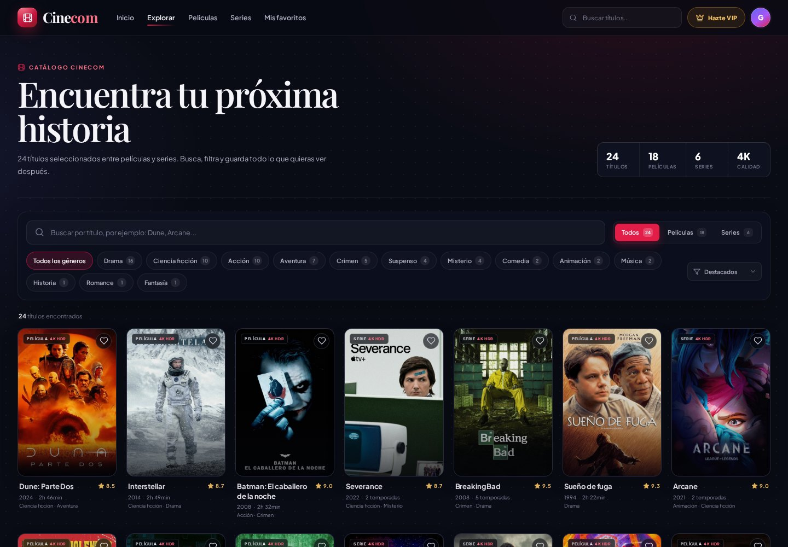
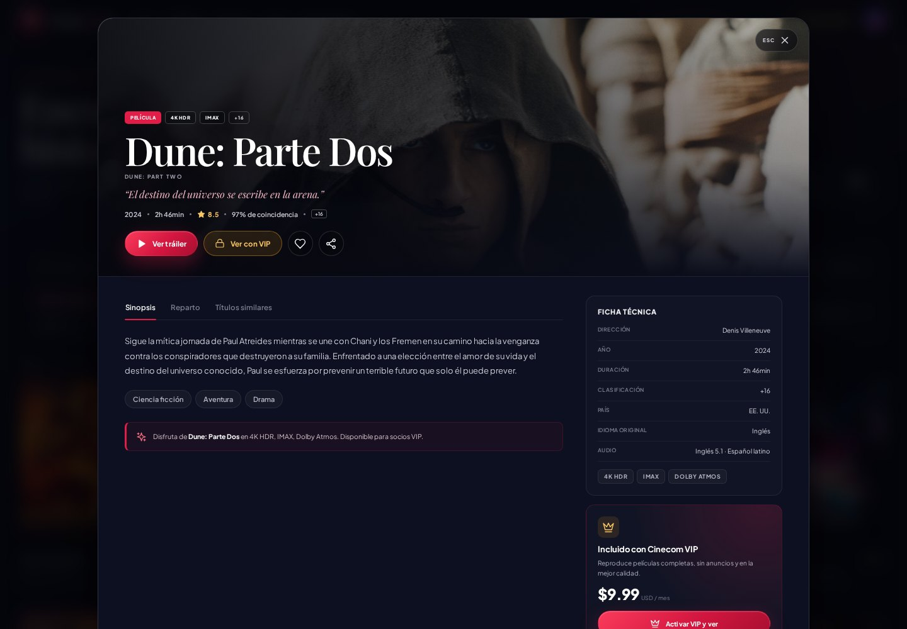
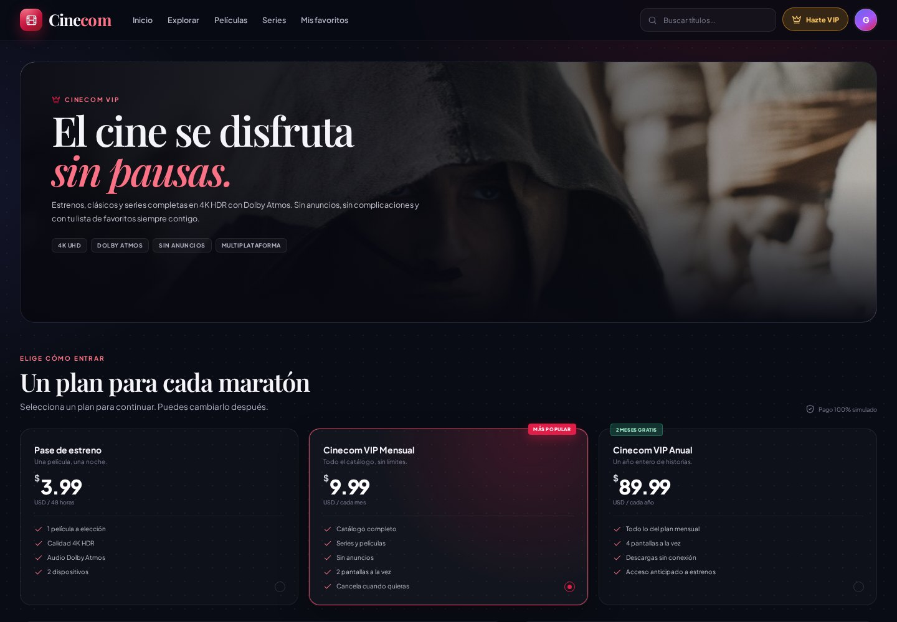

# Cinecom 🎬

Catálogo interactivo de películas y series desarrollado con **React + TypeScript + Vite**. Es un proyecto académico que implementa componentes, estado, eventos, renderizado dinámico, búsqueda, filtros y una suscripción VIP simulada.



## Tecnología seleccionada

- **React 19** con componentes funcionales y hooks (`useState`, `useEffect`, `useRef`).
- **TypeScript** para tipar el catálogo y las props de los componentes.
- **Vite 8** como entorno de desarrollo y empaquetado.
- **CSS puro** con variables de diseño; no se usa una librería de componentes.
- **LocalStorage** para conservar favoritos y suscripción entre visitas.

> No hay backend, base de datos ni consumo de una API en tiempo de ejecución. Todo el catálogo vive en un arreglo local y las imágenes/tráilers están descargados dentro de `public/`.

## Requisitos

- Node.js 20 o superior (el proyecto se probó con Node 24).
- pnpm (recomendado) o npm.

## Instalación y ejecución

```bash
# 1. Instalar dependencias
pnpm install

# 2. Levantar el servidor de desarrollo
pnpm dev

# 3. Abrir la URL que muestra la terminal (por defecto http://localhost:5173)
```

Otros comandos:

```bash
pnpm build      # compila TypeScript y genera la versión de producción en dist/
pnpm preview    # sirve la versión compilada
pnpm lint       # revisa el código con ESLint
```

Con npm:

```bash
npm install
npm run dev
npm run build
```

## Funcionalidades

- **Catálogo de 24 títulos** (18 películas y 6 series) construido a partir de un arreglo de objetos tipado.
- **Tarjetas** con póster, título, año, duración o temporadas, puntuación y géneros.
- **Búsqueda por título** tolerante a mayúsculas y acentos.
- **Filtros** por tipo (película/serie) y por género, además de ordenamiento por destacados, puntuación, año o A–Z.
- **Ficha de detalle** con sinopsis, reparto (fotos y personajes), ficha técnica, calidad y títulos similares.
- **Favoritos**: se marcan y desmarcan desde cualquier tarjeta o desde el detalle. La sección “Mis favoritos” muestra estadísticas, filtros y recomendaciones.
- **Tráilers locales**: cada título reproduce su tráiler descargado en formato MP4 dentro de un reproductor modal.
- **Suscripción VIP simulada**: tres planes, formulario de pago con validación y activación inmediata. Los planes habilitan el reproductor de “película completa” simulado.
- **Reproductor de demostración**: barra de progreso, pausa, ±10 segundos, silencio y pantalla completa. La reproducción es una simulación y está identificada como tal.
- **Persistencia**: favoritos y suscripción se guardan en `localStorage` con las claves `cinecom:favoritos` y `cinecom:suscripcion`.
- **Diseño responsive** para escritorio, tablet y móvil, con menú móvil y buscador adaptado.
- **Accesibilidad básica**: navegación por teclado, cierre con `Escape`, etiquetas ARIA, foco visible y respeto a `prefers-reduced-motion`.

| Catálogo | Ficha de detalle |
| --- | --- |
|  |  |

| Suscripción VIP | Reproductor simulado |
| --- | --- |
|  | La reproducción completa es simulada y se identifica con el aviso “Modo demostración”. |

## Estructura del proyecto

```text
Cinecom/
├── public/
│   ├── backdrops/       # Imágenes de fondo de cada título
│   ├── cast/            # Fotografías del reparto
│   ├── fonts/           # Playfair Display y Plus Jakarta Sans
│   ├── posters/         # Pósters en formato 2:3
│   └── trailers/         # Tráilers MP4 locales
├── src/
│   ├── components/
│   │   ├── Navbar.tsx        # Barra superior, búsqueda global y menú móvil
│   │   ├── Footer.tsx        # Pie de página y enlaces de navegación
│   │   ├── Tarjeta.tsx       # Tarjeta reutilizable de película/serie
│   │   ├── FilaContenido.tsx # Carrusel horizontal con flechas
│   │   ├── ModalDetalle.tsx  # Ficha completa con pestañas
│   │   ├── ModalTrailer.tsx  # Reproductor del tráiler
│   │   ├── Reproductor.tsx   # Reproductor VIP simulado
│   │   ├── Toast.tsx         # Notificaciones breves
│   │   ├── Logo.tsx
│   │   └── Icono.tsx         # Iconos SVG propios
│   ├── pages/
│   │   ├── Inicio.tsx        # Hero, top 10, géneros y recomendaciones
│   │   ├── Catalogo.tsx      # Búsqueda, filtros, orden y cuadrícula
│   │   ├── Favoritos.tsx     # Colección personal y estado vacío
│   │   └── Suscripcion.tsx   # Planes, pago simulado y preguntas frecuentes
│   ├── data/
│   │   └── peliculas.ts      # Arreglo CATALOGO y tipos Contenido/Reparto
│   ├── App.tsx               # Estado principal y navegación entre vistas
│   ├── types.ts              # Tipos de vista, filtros, planes y suscripción
│   ├── utils.ts              # Búsqueda, fechas, duración y formateadores
│   ├── App.css               # Estilos de todos los componentes
│   └── index.css             # Fuentes, variables y estilos base
├── docs/                     # Capturas para este README
├── T3Proyecto.pdf            # Enunciado del proyecto
└── README.md
```

## Cómo se comunican los componentes

`App.tsx` concentra el estado principal: vista actual, búsqueda, filtros, favoritos, suscripción y modales abiertos. Ese estado se pasa a las páginas y componentes mediante **props** y funciones de retorno (`onAbrir`, `onFavorito`, `onTrailer`, `onVerPelicula`). Así se evita introducir una librería de estado externa y se mantiene un nivel intermedio de complejidad.

- **Catálogo** se define en `src/data/peliculas.ts` con el tipo `Contenido`.
- **Tarjeta** recibe un objeto `Contenido` y avisa cuando se abre o cuando cambia su corazón.
- **ModalDetalle** recibe el título seleccionado, sus similares y el estado de favorito/suscripción.
- **Suscripcion** maneja localmente el plan elegido, los campos del pago y los errores de validación. Al confirmar, llama a `onSuscribir(plan)` y `App` guarda la membresía.
- **Reproductor** recibe el título y la suscripción activa; calcula una duración aproximada y simula el avance con `setInterval`.

La navegación entre Inicio, Catálogo, Favoritos y VIP se hace con un estado `vista` en `App`, sin React Router. Es una decisión intencional para mantener el proyecto en un nivel intermedio y concentrar el aprendizaje en componentes, props, estado y eventos.

## Cómo probar el flujo completo

1. Entra a **Explorar** y escribe `dune` en el buscador.
2. Abre una tarjeta y revisa sus pestañas **Sinopsis**, **Reparto** y **Títulos similares**.
3. Pulsa **Ver tráiler** para reproducir el MP4 local.
4. Marca títulos con el corazón y revisa **Mis favoritos**.
5. Pulsa **Ver con VIP** sin suscripción: te llevará a la página de planes.
6. Elige un plan, usa la tarjeta de prueba `4242 4242 4242 4242`, vencimiento `12/30` y CVV `123`.
7. Al confirmar, el plan queda activo y aparece el botón para ver la película completa simulada.
8. Recarga la página: los favoritos y la suscripción deben mantenerse.

## Recursos y aviso académico

- Pósters y backdrops: imágenes públicas de **The Movie Database (TMDB)**, descargadas localmente para la demostración.
- Tráilers: videos de YouTube descargados en baja resolución para que funcionen sin conexión durante la presentación.
- Los derechos de las películas, series, pósters y tráilers pertenecen a sus respectivos distribuidores.
- **Cinecom no es un servicio real de streaming.** El pago y la reproducción VIP son simulaciones académicas; no se realizan cobros ni se distribuye contenido completo.

## Repositorio

[https://github.com/Geovani-ol/Cinecom](https://github.com/Geovani-ol/Cinecom)

## Presentación del proyecto

- [Cinecom-Presentacion.pptx](Cinecom-Presentacion.pptx) — 7 diapositivas para una exposición de 5 minutos, con notas del expositor.
- [Cinecom-Presentacion.pdf](Cinecom-Presentacion.pdf) — versión PDF para revisión rápida.
- [Guion de 5 minutos](presentacion/GUION-5-MIN.md) — guion imprimible y checklist para la demo.
